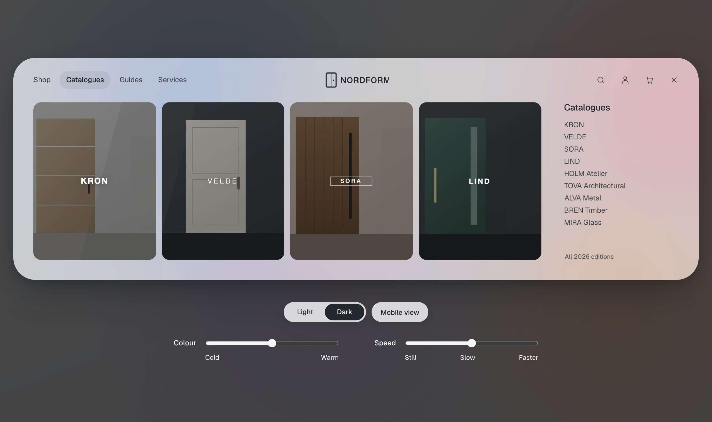
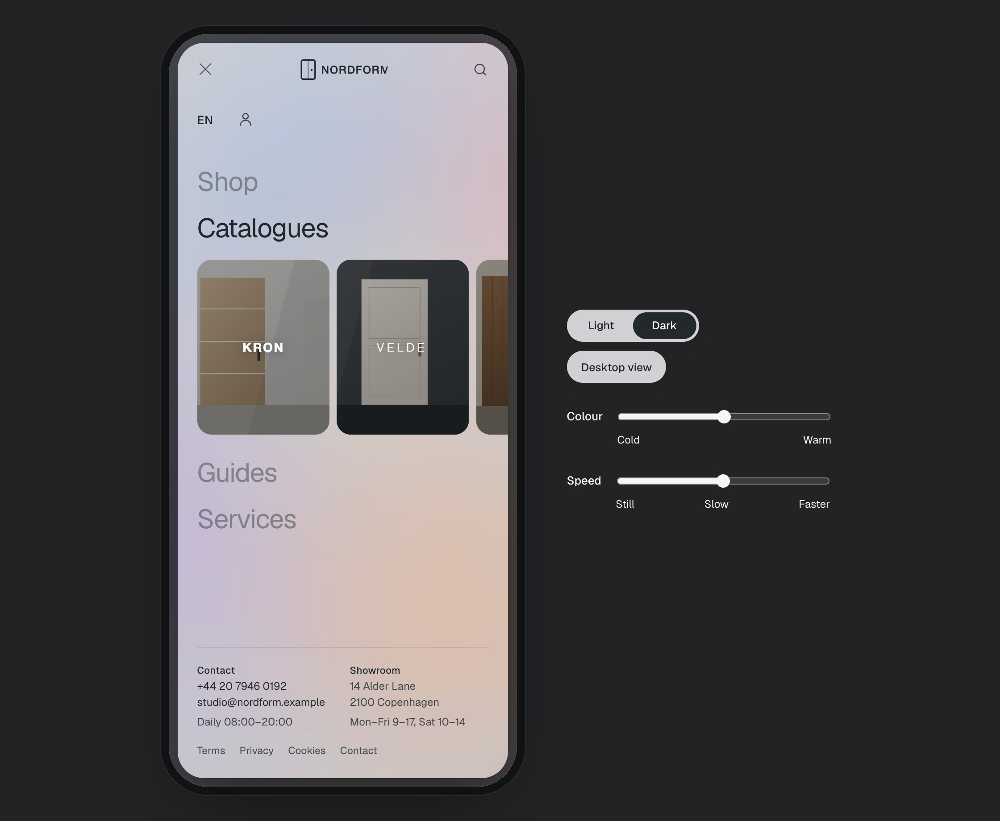

# Adaptive Glass Header

A standalone, brand-neutral reference implementation of a single-surface frosted glass navigation header for desktop and mobile, built in plain HTML, CSS, and JavaScript.



## What this is

This repository extracts the core architecture behind an adaptive glass header I spent six months designing and building for a live architectural joinery store:

- **One glass surface from pill to menu:** On desktop, a single `<header>` element expands smoothly from an `80 px` floating pill (`40 px` radius) into a `388 px` mega-menu while the top bar stays locked in place. On mobile, a `60 px` pill (`30 px` radius) opens downward into the full navigation sheet.
- **Borderless frosted glass with two contrast-tested tones:** No gradient borders, diagonal sheen, or hairline rims — only `backdrop-filter` blur, a restrained tint, and soft drop shadows. Switching between `Light` and `Dark` backdrops swaps the glass sheet (`smoke` with white text vs `frost` with dark charcoal text) and inverts the wordmark.
- **Widening 16:9 department and catalogue tiles:** Hovering or focusing a tile widens it (`flex-grow: 2.4`, `600 ms`) while revealing more of its wide 16:9 composition sideways instead of zooming in. Maker wordmarks in *Catalogues* are optically sized by visual ink area rather than uniform pixel height.
- **Container-sized mobile navigation:** The mobile menu list uses a CSS size container (`container: ghm-nav / size`) to derive card heights from `100cqh` and lift the list upward by half the open accordion height, keeping all four sections and the swipeable card strip visible without creating an inner scroll trap.
- **Pure reducers separated from the DOM:** Desktop (`js/menu-state.js`) and mobile (`js/mobile-state.js`) interaction rules live in pure, frozen-state reducers tested directly under Node.
- **Zero dependencies, strict CSP:** No UI framework, no build step, no animation library, no network requests (`connect-src 'none'`), and zero inline scripts or styles. The header ships `inert` in HTML and activates only once every controller initializes.

*Note on assets:* All brand names (**Nordform**, **KRON**, **VELDE**, **SORA**, **LIND**), SVG scenes, contact details, and copy in this repository are fictional placeholders created specifically for this open-source reference. No client assets, photography, or store code are included.

## Mobile reference



## Run locally

Because the page ships with a strict local Content-Security-Policy and self-hosted fonts (`Geist`, SIL Open Font License), serve the repository folder over any local static server:

```sh
python3 -m http.server 8080
```

Then open:

- Desktop reference: `http://localhost:8080/`
- Mobile reference: `http://localhost:8080/mobile.html`

## Tests

Run the full Node test suite (requires Node 20+, zero npm installs):

```sh
node --test "tests/*.test.mjs"
```

The tests verify:

- Continuous OKLab palette interpolation and WCAG contrast floors across every colour slider stop
- Strict parity between `js/palette.js` constants and CSS custom properties in `css/base.css`
- Desktop hover intent, click-pinning, Escape dismissal, and roving keyboard focus (`js/menu-state.js`)
- Mobile accordion exclusivity, popover/accordion collision avoidance, and language switching (`js/mobile-state.js`)
- Diacritic-insensitive client-side search indexing, including Polish `ł` (`js/search-index.js`)
- Static Content-Security-Policy, zero remote resources, pointer hover gating, reduced motion and transparency CSS rules, plus automated checks confirming no client identifiers appear in the repository

## Project layout

```text
index.html            Desktop reference stage and 7 header panes
mobile.html           Mobile phone-frame / responsive viewport reference
css/
  base.css            Tokens, OKLab colour diffusion stage, light/dark themes
  header.css          Single glass shell, bar grid, sliding clipped nav highlight
  menu.css            Staggered reveal, 4-tile flex-grow accordion row
  panes.css           Geist font faces, Services :has() preview swap, bar search
  catalogues.css      Wide scene anchor positions, optical mark sizing, scrims
  glass.css           Borderless shadow tokens and tone-based wordmark swap
  mobile.css          60px pill-to-sheet layout, 1.2px optical burger, 100cqh container
js/
  palette.js          Pure OKLab blending and WCAG contrast helpers
  motion.js           Pure drift paths, phase integration, and fit scaling
  menu-state.js       Pure desktop interaction reducer
  mobile-state.js     Pure mobile interaction reducer
  search-index.js     Pure diacritic-folded search index
  header-menu.js      Desktop DOM controller and local search binding
  mobile-header.js    Mobile DOM controller and mouse drag-scroll
  stage.js            rAF colour drift and pause-on-interaction float
  background.js       Light/dark backdrop tone switch
  main.js             Desktop composition root
  mobile-main.js      Mobile composition root
tests/
  logic.test.mjs      Palette, contrast, token parity, motion, desktop reducer
  mobile.test.mjs     Mobile reducer, search index, mobile markup
  structure.test.mjs  CSP, motion rules, asset integrity, brand hygiene
```

## Write-up

Read the full design and engineering note at [cbmvula.com/journal-one-glass-surface-from-pill-to-menu.html](https://cbmvula.com/journal-one-glass-surface-from-pill-to-menu.html).

## License

MIT — see [LICENSE](LICENSE).
